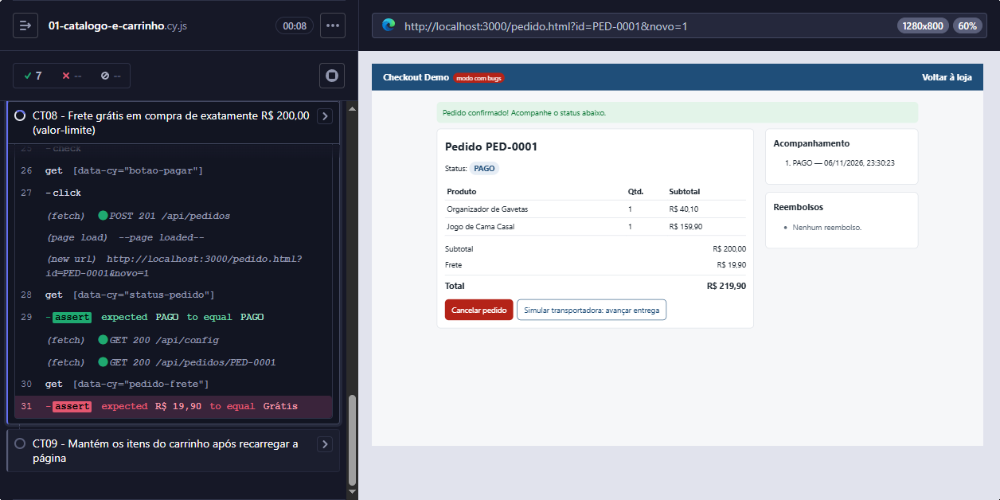

# BUG-01 — Frete cobrado em compra de exatamente R$ 200,00, embora o carrinho mostre "Grátis"

| Campo | Valor |
|---|---|
| **Severidade** | Alta |
| **Prioridade** | Alta |
| **Componente** | Checkout / cálculo de frete (API) |
| **Ambiente** | Local, `npm run start:bugs`, Edge 156, Windows 10 |
| **Encontrado por** | Teste automatizado CT08 (valor-limite) |
| **Risco relacionado** | R02 — valor cobrado errado |
| **Status** | Aberto |

## Resumo

A regra de negócio diz que o frete é grátis para compras **a partir de** R$ 200,00. Em uma compra de **exatamente** R$ 200,00, o carrinho e o checkout mostram frete "Grátis" e total de R$ 200,00, mas o pedido criado cobra **R$ 19,90 de frete** e total de **R$ 219,90**.

## Pré-condições

- Loja com os dados iniciais (`POST /api/test/reset`).

## Passos para reproduzir

1. Acessar a loja em `http://localhost:3000`.
2. Adicionar ao carrinho **Organizador de Gavetas** (R$ 40,10).
3. Adicionar ao carrinho **Jogo de Cama Casal** (R$ 159,90).
4. Conferir no carrinho: subtotal R$ 200,00, frete "Grátis", total R$ 200,00.
5. Clicar em **Finalizar compra**.
6. Preencher nome "Ana Souza", e-mail "ana@exemplo.com" e CEP "01310-100".
7. Escolher **Pix** e clicar em **Pagar e confirmar pedido**.
8. Conferir o frete e o total na página do pedido.

## Resultado esperado

Pedido com frete **Grátis** e total de **R$ 200,00**, igual ao que foi exibido no carrinho.

## Resultado obtido

Pedido com frete de **R$ 19,90** e total de **R$ 219,90**.

## Evidências



Resposta da API (`POST /api/pedidos`):

```json
{ "subtotal": 200, "frete": 19.9, "total": 219.9 }
```

## Impacto

- O cliente paga R$ 19,90 a mais do que o valor mostrado antes da confirmação, o que pode gerar reclamação, estorno e problema com o Código de Defesa do Consumidor.
- Afeta só o valor-limite: compras de R$ 200,01 ou mais recebem o frete grátis corretamente, por isso o erro passa despercebido em testes com valores "redondos".

## Observação para o desenvolvimento

A tela e a API usam comparações diferentes no limite: a tela considera "maior **ou igual** a R$ 200,00", e a API considera apenas "**maior** que R$ 200,00". Sugestão: centralizar a regra na API e fazer a tela exibir o frete calculado por ela.

## Reteste

Após a correção, reexecutar o CT08 e a regressão do carrinho e do checkout (CT03, CT04, CT07, CT10 e CT11).
