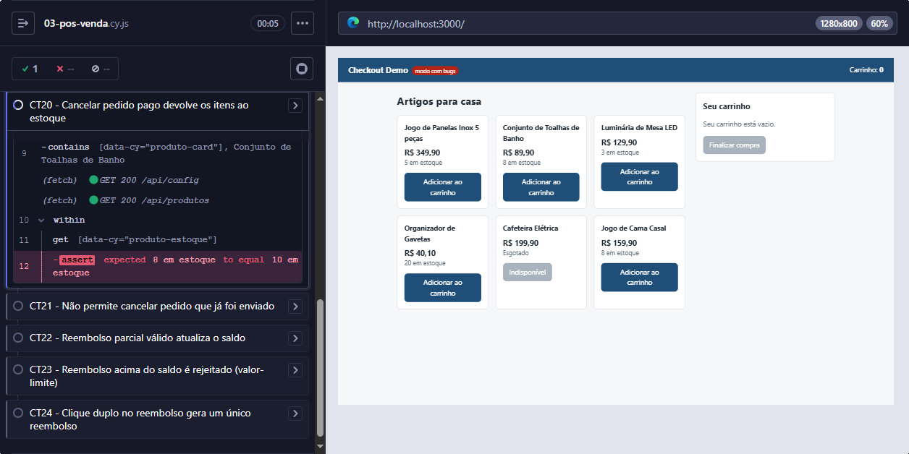

# BUG-02 — Cancelamento do pedido não devolve os itens ao estoque

| Campo | Valor |
|---|---|
| **Severidade** | Média |
| **Prioridade** | Alta |
| **Componente** | Pós-venda / cancelamento (API) |
| **Ambiente** | Local, `npm run start:bugs`, Edge 156, Windows 10 |
| **Encontrado por** | Teste automatizado CT20 |
| **Risco relacionado** | R05 — cancelamento não devolver os itens ao estoque |
| **Status** | Aberto |

## Resumo

Ao cancelar um pedido que ainda não foi enviado, o pedido muda para `CANCELADO` e o valor é reembolsado, mas **os itens não voltam ao estoque**. O produto continua com o estoque reduzido, como se a venda tivesse acontecido.

## Pré-condições

- Loja com os dados iniciais (`POST /api/test/reset`).
- **Conjunto de Toalhas de Banho** com 10 unidades em estoque.

## Passos para reproduzir

1. Comprar 2 unidades de **Conjunto de Toalhas de Banho**, pagando com Pix.
2. Na página inicial, conferir que o produto mostra "8 em estoque".
3. Abrir a página do pedido (status `PAGO`).
4. Clicar em **Cancelar pedido**.
5. Conferir que o pedido mudou para `CANCELADO`.
6. Voltar à página inicial e conferir o estoque do produto.

## Resultado esperado

O produto volta a mostrar **"10 em estoque"**.

## Resultado obtido

O produto continua mostrando **"8 em estoque"**.

## Evidências



Consulta à API depois do cancelamento (`GET /api/produtos/2`):

```json
{ "id": 2, "nome": "Conjunto de Toalhas de Banho", "preco": 89.9, "estoque": 8 }
```

## Impacto

- **Perda de vendas:** unidades disponíveis ficam bloqueadas e, com cancelamentos repetidos, o produto pode aparecer como esgotado tendo estoque físico.
- **Estoque divergente** entre o sistema e as lojas físicas, o que atrapalha a reposição.
- Severidade média porque não cobra o cliente indevidamente, mas prioridade alta pelo efeito acumulado nas vendas.

## Reteste

Após a correção, reexecutar o CT20 e a regressão de estoque (CT02, CT06 e CT18) e de cancelamento (CT21 e API13).
