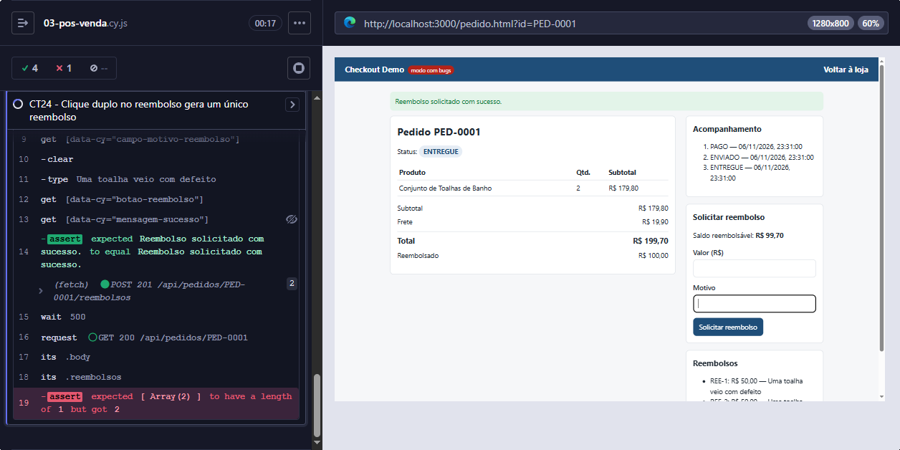

# BUG-03 — Clique duplo em "Solicitar reembolso" gera dois reembolsos

| Campo | Valor |
|---|---|
| **Severidade** | Crítica |
| **Prioridade** | Alta |
| **Componente** | Pós-venda / reembolso (tela e API) |
| **Ambiente** | Local, `npm run start:bugs`, Edge 156, Windows 10 |
| **Encontrado por** | Teste automatizado CT24 (E2E) e API10 (Postman/Newman) |
| **Risco relacionado** | R01 — reembolso pago em duplicidade |
| **Status** | Aberto |

## Resumo

Ao clicar duas vezes seguidas em **Solicitar reembolso**, o sistema registra **dois reembolsos** com o mesmo valor e o mesmo motivo. A mesma falha acontece direto na API: enviar duas vezes a mesma solicitação, com a mesma chave, cria dois reembolsos.

## Pré-condições

- Pedido com 2 unidades de **Conjunto de Toalhas de Banho**, total de R$ 199,70 (R$ 179,80 + frete de R$ 19,90), com status `ENTREGUE`.

## Passos para reproduzir

**Pela tela**

1. Abrir a página do pedido entregue.
2. Preencher o valor **50,00** e o motivo "Uma toalha veio com defeito".
3. Clicar **duas vezes seguidas** em **Solicitar reembolso**.
4. Conferir a lista de reembolsos e o saldo reembolsável.

**Pela API**

1. Enviar `POST /api/pedidos/{id}/reembolsos` com o corpo abaixo.
2. Enviar a mesma requisição de novo, com a **mesma** `chave`.

```json
{ "valor": 50, "motivo": "Uma toalha veio com defeito", "chave": "3f1c2a9e-0000-4000-8000-000000000001" }
```

## Resultado esperado

- Apenas **1 reembolso** de R$ 50,00 e saldo reembolsável de **R$ 149,70**.
- Na API, a segunda requisição responde **200** com o reembolso já existente, sem criar outro.
- Na tela, o botão fica bloqueado enquanto a solicitação é processada.

## Resultado obtido

- **2 reembolsos** de R$ 50,00 (REE-1 e REE-2), total reembolsado de R$ 100,00 e saldo de **R$ 99,70**.
- Na API, as duas requisições respondem **201** e criam reembolsos diferentes.
- O botão continua clicável durante o processamento.

## Evidências



Falha registrada pelo Newman na API10:

```
1.  AssertionError  Status 200
                    expected response to have status code 200 but got 201
2.  AssertionError  Nenhum reembolso novo foi criado
                    expected [ …(2) ] to have a length of 1 but got 2
3.  AssertionError  Saldo continua R$ 99,80
                    expected 49.8 to deeply equal 99.8
```

Validação no banco (`npm run sql:validar`, consulta **V04**): a mesma chave de solicitação aparece em dois reembolsos.

```sql
SELECT pedido_id, chave, COUNT(*) AS vezes, SUM(valor_centavos) AS total_centavos
FROM reembolsos
WHERE chave IS NOT NULL
GROUP BY pedido_id, chave
HAVING COUNT(*) > 1;
```

| pedido_id | chave | vezes | total_centavos |
|---|---|---|---|
| PED-0002 | 3f1c2a9e-0000-4000-8000-000000000001 | 2 | 10000 |

## Impacto

- **Prejuízo financeiro direto:** a empresa devolve ao cliente mais do que deveria.
- Fácil de acontecer sem má-fé: clique duplo, internet lenta ou o cliente atualizando a página.
- Efeito em cascata: o saldo reembolsável fica errado, e um reembolso legítimo posterior pode ser recusado (a API12 falha pelo mesmo motivo).

## Observação para o desenvolvimento

O problema tem duas partes, e as duas precisam ser corrigidas:

1. **API (causa principal):** a chave da solicitação não está sendo verificada, então a operação não é idempotente. A mesma chave precisa devolver o reembolso já criado. Como proteção extra no banco, um índice único em `(pedido_id, chave)` impediria a gravação duplicada.
2. **Tela (proteção extra):** o botão deve ser desabilitado enquanto a requisição está em andamento.

Corrigir só a tela não resolve: a requisição repetida pode vir de reenvio automático, de outra aba ou de uma integração.

## Reteste

Após a correção, reexecutar o CT24 e a API10, além da regressão de reembolso (CT22, CT23, API09, API11 e API12).
